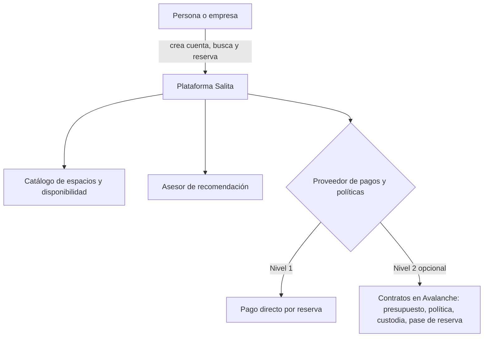

# Salita

**Una sola plataforma para encontrar, reservar y administrar los espacios de trabajo de personas y empresas: coworks y salas de reuniones por hora, y oficinas por mes. Simple para quien solo quiere reservar, y automatizable con contratos inteligentes en Avalanche para quien administra los espacios de un equipo.**

> Estado: demo frontend para el Ideathon Avalanche Chile, con datos ficticios. Las billeteras, la multifirma y las referencias a Fuji son simuladas, sin conexión a blockchain ni fondos reales. No está listo para producción. Los niveles descritos en la solución son la visión del producto; las secciones 5 y 9 detallan lo disponible hoy.

## Resumen

- **Problema:** trabajar de forma híbrida obliga a gestionar varios espacios (oficinas, coworks, salas), cada uno con su proveedor, tarifa y forma de pago. Esa carga operacional es una barrera de entrada para empresas y profesionales independientes.
- **Solución:** Salita centraliza la búsqueda, la reserva y el pago. Se usa creando una cuenta y reservando (nivel 1), y las empresas pueden activar una automatización opcional de presupuestos y reglas de gasto (nivel 2).
- **Dónde entra Avalanche:** es la infraestructura prevista para automatizar y auditar el gasto corporativo del nivel 2. Hoy el frontend simula billeteras y autorizaciones; los contratos, la custodia hasta el check-in y el registro verificable están pendientes. La demo se recorre sin conectar una wallet.
- **Un caso de uso clave:** administrar todos los espacios desde un solo panel aunque la empresa abra operaciones en otra ciudad o tenga personas lejos de su sede.

## Contenido

1. [El problema](#1-el-problema)
2. [Datos que lo respaldan](#2-datos-que-lo-respaldan)
3. [La solución](#3-la-solución)
4. [Casos de uso](#4-casos-de-uso)
5. [Demo](#5-demo)
6. [Salita es más grande que una cadena](#6-salita-es-más-grande-que-una-cadena)
7. [Qué aporta Avalanche](#7-qué-aporta-avalanche)
8. [Contratos del nivel 2](#8-contratos-del-nivel-2)
9. [Estado del prototipo](#9-estado-del-prototipo)
10. [Cómo ejecutarlo](#10-cómo-ejecutarlo)
11. [Alcance y límites](#11-alcance-y-límites)
12. [Hoja de ruta](#12-hoja-de-ruta)
13. [Fuentes](#13-fuentes)

---

## 1. El problema

Trabajar de forma híbrida suena simple, pero tiene una barrera de entrada que casi nadie ve hasta que la enfrenta: **hay que hacerse cargo de los costos operacionales de gestionar distintos espacios**.

- Un equipo con personas en distintas comunas necesita oficinas, coworks para quienes trabajan remoto y salas de reuniones para encuentros puntuales. Cada espacio tiene su propio proveedor, su propia tarifa, sus propias reglas y su propia forma de pago.
- Alguien tiene que buscar, comparar, reservar, pagar, conciliar facturas y controlar que nadie gaste fuera de lo acordado. Ese trabajo administrativo es un costo real, aunque no aparezca en la tarifa del espacio.
- La oferta habitual está pensada para compromisos mensuales por persona. Existen pases diarios y tarifas por hora en algunos espacios, pero están dispersos y no se administran en conjunto.
- Para un independiente o una empresa pequeña, esa carga pesa tanto que muchas veces se descarta el modelo híbrido, o se termina pagando de más por espacios que no se usan.
- Para una empresa con varias sedes o personas lejos de su central, el problema se multiplica: cada ciudad nueva es otro proveedor, otro contrato y otro proceso de pago.

## 2. Datos que lo respaldan

### Chile: trabajo remoto e híbrido

Según la Dirección del Trabajo (DT), con registros de la Ley 21.220 (informe difundido a mediados de 2026):

| Indicador | Dato |
| --- | --- |
| Trabajadores en teletrabajo o trabajo a distancia | 149.816, contratados por 6.108 empresas, con 162.312 pactos vigentes |
| Modalidad | 44% solo teletrabajo, 51,2% lo combina con trabajo presencial (híbrido), 4,9% trabajo a distancia |
| Ubicación | más del 87% en la Región Metropolitana |
| Rubros principales | actividades profesionales, comercio e información y comunicaciones |
| Tamaño de empresa | las microempresas concentran el 28,4% de los pactos vigentes |

Cálculos propios sobre esas cifras: unos 76.700 trabajadores híbridos y unos 65.900 solo en teletrabajo. Además, a febrero de 2021 (primer año de la ley) había 88.819 pactos vigentes, por lo que los actuales representan un aumento cercano a 83% (las fuentes y fechas son distintas).

**Límite del dato:** solo cuenta los pactos registrados. Frente a los 9,3 millones de ocupados del país (INE, mayo-julio 2025), esas 150 mil personas equivalen a cerca de 1,6% (cálculo propio, fechas distintas), y es probable que el trabajo híbrido informal quede fuera. Por eso hablamos de "al menos 150 mil".

### Contexto internacional

- **Gallup** (mayo de 2026, empleados con trabajo remoto posible, principalmente EE. UU.): 52% híbrido, 26% totalmente remoto y 22% presencial. En noviembre de 2025, 61% prefería el modelo híbrido.
- **Quién define la modalidad:** la proporción de empleados que dice decidir libremente su horario híbrido bajó de 37% a 34% entre 2024 y 2025 (Gallup, EE. UU.). Es una señal de que la modalidad la fijan cada vez más las organizaciones, lo que hace relevante dar herramientas a quienes administran los espacios del equipo.
- **Adopción corporativa** (compilación secundaria): 55% de las corporaciones usa espacios flexibles y 77% opera con modelos híbridos.
- **Tamaño de mercado:** las estimaciones varían mucho según la consultora (entre unos US$20.000 y US$30.000 millones para 2026). No usamos una cifra única.

### Chile: concentración empresarial

- La Región Metropolitana concentra el **43%** de las empresas del país (unas 602 mil) y el **79%** de las ventas declaradas (SII, Operación Renta 2022). La Corfo midió 43,0% de las empresas en 2020.
- Por comuna (SII, Operación Renta 2024): Santiago tiene 82.442 de 1,5 millones de empresas (5,48%), Las Condes 81.795 (5,43%) y Providencia 74.835 (4,97%). Las Condes explica por sí sola más de 41% de las ventas declaradas.
- El área metropolitana de Santiago reúne cerca de 39% de la población del país (INE, 2024).

**Cómo leer estas cifras:** el SII asigna las ventas según el domicilio o la casa matriz declarados, no según dónde ocurre la actividad. Miden dónde están **registradas** las casas matrices, no dónde está toda la economía.

La consecuencia para Salita: las decisiones de gasto en espacios suelen tomarse en la casa matriz, pero los equipos y las operaciones pueden estar en otras ciudades.

### Qué hacen otras plataformas

| Plataforma | Qué hace | Dato clave |
| --- | --- | --- |
| **Croissant** (EE. UU.) | Acceso por horas a una red de coworks, hoy orientado a equipos | 800+ espacios en 40+ ciudades para equipos de 10 a 100 personas, sin contratos ni reembolsos; paga a cada espacio por visita y se presenta como control del gasto según el uso |
| **Pluria** (Rumania y España) | Suscripción B2B para equipos distribuidos | Red en 150 ciudades de Latinoamérica y Europa; más de US$6 millones levantados |
| **Letswork** (Dubái) | Convierte la capacidad ociosa de hoteles y restaurantes en coworks | Un banco dio a sus empleados acceso a más de 100 espacios en Dubái y 25 más en otros emiratos |
| **IWG** (Regus, Spaces) | Operador global | 4.609 centros en más de 120 países al cierre de 2025 (fuente secundaria) |

Tres cambios que muestran estos casos: se pasa de arriendos largos a **acceso por uso**, de modelos con edificios propios a **redes con pocos activos**, y de la demanda individual a la **demanda de equipos y empresas**. Aun así, el espacio flexible sigue siendo una fracción pequeña de la oferta de oficinas (cerca de 2% del inventario de EE. UU.), así que es un cambio real pero parcial.

Estas plataformas demuestran que el modelo existe. Salita se enfoca en Chile y suma la **automatización verificable de presupuestos y políticas** con contratos inteligentes. [VERIFICAR competencia antes de entregar: confirmar qué ofrecen hoy estas plataformas en control de gasto.]

## 3. La solución

Salita **centraliza la búsqueda, la reserva y el pago de espacios de trabajo**, y funciona en dos niveles.

### Nivel 1: simple para cualquiera
1. **Crea una cuenta.**
2. **Encuentra el lugar ideal.** Filtra por tipo de espacio, ciudad o comuna, capacidad y servicios, o cuéntale tu necesidad en lenguaje natural al asesor.
3. **Reserva y paga.** Hay dos formas de precio, según el espacio:
   - **Por hora**, para coworks y salas de reuniones: `horas x precio por hora`.
   - **Por mes**, para oficinas: precio mensual del espacio.

   Sin membresías ni paquetes de horas.

Esto es todo lo que necesita un profesional independiente o un equipo pequeño.

### Nivel 2: automatización opcional para equipos
Cuando una empresa quiere dejar de aprobar y conciliar a mano, activa la automatización:
- **Presupuesto:** la empresa fondea un presupuesto en un contrato inteligente.
- **Política:** define reglas una vez (tope mensual por persona, tipos de espacio y ciudades permitidas, horarios).
- **Reservas automáticas:** cada reserva se valida contra la política y se paga sola. Lo que se sale de las reglas es rechazado sin intervención humana.
- **Auditoría:** cada reserva y pago queda en un registro verificable.

La automatización es un **módulo opcional**, no un requisito: la plataforma funciona sin ella.

## 4. Casos de uso

1. **Abrir operación en otra ciudad.** Una empresa con sede en Santiago abre una oficina o un equipo en otra ciudad. En lugar de buscar proveedores, negociar y pagar por separado, agrega la ciudad a su panel de Salita, con el mismo presupuesto y las mismas reglas.
2. **Personas lejos de la sede.** La empresa define una regla una vez, por ejemplo "quien viva fuera de la ciudad de la sede puede usar hasta N horas al mes en un espacio de su zona", y se aplica sola.
3. **Equipo híbrido en una sola ciudad.** Combina oficinas mensuales para el núcleo del equipo, coworks por hora para quienes vienen algunos días y salas de reuniones para encuentros puntuales, todo administrado desde un solo lugar.
4. **Profesional independiente.** Crea una cuenta, reserva por hora y paga solo lo que usa, sin necesidad de un contrato.

**Cobertura:** la oferta de cada ciudad se suma bajo demanda. Cuando una empresa necesita una ciudad, Salita invita a espacios locales a incorporarse mediante el flujo "Únete a nosotros". En la demo, las ciudades distintas de Santiago son simuladas.

## 5. Demo

Salita permite descubrir y reservar **coworks y salas de reuniones por hora**. El sitio actual reúne un catálogo por categorías (`/espacios`), filtros, mapa, fichas de ubicaciones y un flujo de reserva con fecha, horario, asistentes y total en CLP (`horas × precio por hora`).

Hay dos experiencias sobre el mismo catálogo: **individual**, para reservar por cuenta propia, y **corporativa**, con portales separados para quien administra el presupuesto y quien solicita usarlo. Los portales son vistas de demostración accesibles sin iniciar sesión; no representan cuentas autenticadas.

- **Reserva individual:** se recorre el flujo sin crear una cuenta, se revisa el resumen y se llega a un pago simulado con pantalla de confirmación. No se cobra ni se guarda la reserva. El arriendo mensual de oficinas descrito en la propuesta no forma parte de este recorrido.
- **Empresa (`/empresa`):** muestra una billetera inteligente ficticia, saldo, transacciones, un panel de multifirma de 2 de 3 firmantes y solicitudes pendientes. Permite aprobar/rechazar y ajustar o quitar los topes individuales de colaboradores.
- **Empleado (`/empleado`):** muestra la asignación disponible de una persona ficticia, permite explorar espacios y solicitar financiamiento para una reserva concreta, y presenta historial y línea de tiempo de estados. No existe una solicitud independiente para recargar fondos.

La asignación disponible es el tope individual menos el gasto aprobado. Si no hay tope individual, la aprobación sigue limitada por el saldo de la empresa. Para iniciar una solicitud, entra desde **Explorar coworks** o **Explorar salas de reuniones** en el portal empleado; también puedes activar **Usar demo de empresa** dentro de una reserva. **Reservar por mi cuenta** vuelve al recorrido individual.

El flujo implementado es **solicitud pendiente → aprobación o rechazo → actualización del historial**. Enviar se bloquea si supera la asignación disponible; aprobar se bloquea si supera el tope vigente o el saldo corporativo. Al aprobar se descuenta el saldo ficticio y se aumenta el gasto del empleado; al rechazar no se descuentan fondos. La multifirma es informativa: no recoge firmas ni condiciona la aprobación.

### Tutorial breve para el jurado

1. Inicia la demo sincronizada de la sección 10 y abre las dos pestañas indicadas. En **Empresa**, pulsa **Reiniciar demo** si necesitas volver a los datos iniciales.
2. En **Empleado**, revisa la asignación y pulsa **Explorar coworks** o **Explorar salas de reuniones**. Busca un espacio mediante los filtros o el mapa y entra a su ficha y reserva.
3. Elige espacio, fecha habilitada, horario disponible y asistentes. Revisa el total; inicialmente hay **$57.000 CLP disponibles**. Si lo supera, reduce la reserva o aumenta el tope desde Empresa.
4. En el resumen, pulsa **Solicitar a mi empresa** y confirma con **Solicitar aprobación**. Vuelve automáticamente al portal empleado con estado **Pendiente**.
5. En **Empresa**, encuentra esa solicitud en **Solicitudes pendientes** y pulsa **Aprobar** o **Rechazar**. En la demo sincronizada, ambas pestañas reflejan la decisión sin recargar; el empleado ve el estado y la línea de tiempo actualizados. Puedes enviar otra solicitud para probar la otra decisión.
6. Para probar el recorrido individual, selecciona **Reservar por mi cuenta** en una reserva y continúa hasta **Confirmar pago simulado**.

**El recorrido corporativo termina en la decisión:** no confirma una reserva con el proveedor. La etapa «Reserva completada (simulada)» queda pendiente; no hay check-in, custodia, pago, token de acceso ni transacción consultable en Fuji. En una publicación sin sincronización, cambia entre portales mediante los enlaces del sitio en **la misma pestaña**, sin recargar, para conservar el estado.

## 6. Salita es más grande que una cadena

Esta sección describe la arquitectura propuesta; la demo actual simula el proveedor corporativo en el frontend.

Salita es una plataforma de espacios de trabajo. La tecnología de Avalanche es **una de las formas de ejecutar pagos y políticas**, y la integramos donde aporta valor, sin atar el producto a ella.



La arquitectura propuesta contempla una interfaz de **proveedor de pagos y políticas**: cobro directo por reserva en el nivel 1 y contratos de Avalanche en el nivel 2. La demo actual representa ambos recorridos sin ejecutar cobros ni contratos. A futuro se podrían sumar una pasarela de pago o integraciones contables.

## 7. Qué aporta Avalanche

El nivel 2 propone usar Avalanche para las siguientes funciones, todavía pendientes de integración real:

La demo ilustra esa propuesta con saldo corporativo, presupuestos por empleado, decisiones de aprobación y referencias ficticias de autorización. **Las interacciones funcionan en el frontend; no son operaciones en Avalanche.** La tarjeta de una solicitud aprobada muestra Fuji «sin conexión» y firmantes sin firmar. La experiencia «sin AVAX» también es simulada: no intervienen un paymaster ni un servicio que pague comisiones.

| Necesidad de un equipo | Función prevista del contrato inteligente |
| --- | --- |
| Controlar el gasto sin aprobar a mano | Aplica el presupuesto y las reglas de forma automática y rechaza lo que se sale de la política |
| Mismas reglas en varias ciudades | Una sola política y un solo presupuesto cubren todas las ciudades, con el registro consolidado |
| Confianza entre empresa y espacio | Retiene el pago en custodia y lo libera solo cuando hay check-in; devuelve los fondos si se cancela a tiempo |
| Auditoría | Deja un registro verificable de reservas y pagos que nadie puede alterar después |
| Evitar fraudes | El pase de reserva es un token no transferible: no se puede falsificar ni revender |
| Seguridad administrativa | Cambiar presupuestos o políticas requiere varias firmas (multifirma) |

**Qué pasa sin Avalanche:** hoy se pueden recorrer ambas experiencias de la demo. La integración futura aportaría ejecución y trazabilidad verificables a los presupuestos y políticas corporativos.

**Privacidad prevista:** los contratos registrarían identificadores, montos y estados; los perfiles y detalles de las reservas quedarían fuera de la cadena. La demo actual no envía datos a blockchain.

### Por qué Avalanche

> [VERIFICAR cada punto contra la documentación oficial antes de entregar.]

- **Compatible con EVM:** los contratos se escriben en Solidity y se usan herramientas conocidas (Hardhat o Foundry, viem, wagmi), lo que acelera el desarrollo.
- **Costos y tiempos de confirmación bajos:** una reserva necesita transacciones baratas y rápidas. [VERIFICAR cifras actuales.]
- **Testnet Fuji:** red prevista para integrar y validar contratos con tokens de prueba en la fase Hackathon; la demo actual no se conecta a ella.
- **Pagos para agentes de IA (x402):** encaja con un asesor que pueda actuar y pagar dentro de límites definidos.
- **Camino de crecimiento:** una L1 propia de Avalanche permitiría más adelante personalizar reglas y comisiones. No es parte del prototipo.

## 8. Contratos del nivel 2

Diseño previsto para la fase Hackathon, no contratos ejecutados por esta demo:

- **BudgetVault:** custodia el presupuesto de la empresa y aplica topes y reglas por persona, tipo de espacio y ciudad.
- **BookingManager:** crea reservas, valida la política, retiene el pago y lo libera en el check-in o lo devuelve si se cancela a tiempo.
- **BookingPass:** token no transferible que sirve de pase de reserva.
- **Administración:** cambios de política con multifirma.

Hoy los cálculos usan CLP y la interfaz muestra un equivalente USDC con una tasa fija **provisional** de 950 CLP por USDC. No se emite ni transfiere ningún token; la denominación definitiva del presupuesto sigue abierta.

## 9. Estado del prototipo

| Alcance | Estado actual |
| --- | --- |
| Descubrimiento y reserva individual | Frontend navegable: catálogo, filtros, mapa, selección, cálculo por hora, pago y confirmación simulados |
| Portales corporativos | Solicitudes, decisiones, topes, saldos e historial interactivos sobre datos ficticios |
| Sincronización local | Implementada con relé de desarrollo; no disponible en la publicación estática |
| Billeteras, multifirma y experiencia sin AVAX | Representación visual; sin conexión, firmas ni pago de comisiones real |
| Cuentas y reservas reales | Pendientes: autenticación, persistencia y confirmación con proveedores |
| Avalanche | Pendientes: contratos, custodia, check-in, devoluciones, pase y verificación en Fuji |

**Punto de partida:** proyecto base Salita con Vite, React y TypeScript, extendido con los portales del demo corporativo. **Herramientas de IA:** Codex se utilizó para contrastar esta documentación con el código; queda por completar el registro de otras herramientas y su uso en el desarrollo.

### AVAXSKILLS: guías y estado

El proyecto incluye `avaxskills` como dependencia. Esta tabla distingue los elementos visibles del demo de las integraciones pendientes, sin afirmar que exista un servicio blockchain operativo.

| Guía | Evidencia en el demo / pendiente |
| --- | --- |
| `safe-multisig` | Panel y firmantes ficticios; sin recolección ni validación de firmas |
| `account-abstraction` | Mensaje de reservas sin AVAX; bundler y paymaster pendientes |
| `evm-foundry` | Contratos propuestos en la sección 8; despliegue pendiente |
| `viem` | Lecturas reales de cadena pendientes; el estado corporativo vive en memoria |
| `evm-wallet-integration` | Direcciones y conexión simuladas; conexión real pendiente |
| `security` | Validación local de topes, saldo y rol en acciones; sin autenticación real entre portales |
| `testing` | No ejecutado en esta actualización documental; no se certifica cobertura |

## 10. Cómo ejecutarlo

Requisitos: **Node.js 22.18 o superior** y npm. Ejecuta desde la carpeta del repositorio; no necesitas wallet, AVAX ni configurar servicios externos.

```bash
npm install
npm run dev
```

El servidor está configurado en **http://localhost:3000**; si está ocupado, usa la URL que indique Vite. Puedes abrir `/empresa` y `/empleado` en pestañas separadas, pero **`npm run dev` por sí solo no sincroniza las pestañas**. Para conservar los cambios sin relé, navega entre portales en la misma pestaña mediante los enlaces del sitio, sin recargar.

### Demo en dos sesiones sincronizadas (solo desarrollo)

Después de `npm install`, ejecuta este comando **en lugar de** `npm run dev`:

```bash
node scripts/demo.mjs
```

Levanta el mismo frontend dos veces y un relé local de estado, todo en `localhost`:

| Sesión | URL |
|--------|-----|
| Empresa | http://localhost:5173/empresa |
| Empleado | http://localhost:5174/empleado |
| Relé de sincronización | http://localhost:5175 (sin interfaz) |

Abre Empresa y Empleado en **dos pestañas del mismo computador** y sigue el tutorial de la sección 5. Los puertos 5173, 5174 y 5175 deben estar libres; el script no cambia de puerto automáticamente.

La sincronización está implementada con un relé HTTP en memoria y eventos del servidor (SSE), habilitado solo en desarrollo. Sin relé, cada pestaña mantiene su propio estado y recargar restaura los datos iniciales. Con relé activo, las sesiones reciben el estado compartido. **Reiniciar demo** restablece los datos de ejemplo y los propaga; detener todos los procesos y cerrar las pestañas elimina el estado temporal. No hay persistencia ni backend de producción. Detalles en [docs/demo-sync.md](docs/demo-sync.md).

### Publicar el frontend en Vercel desde GitHub

1. En Vercel, crea un proyecto, conecta GitHub e importa el repositorio de Salita con la versión del demo que quieras publicar.
2. Selecciona la raíz del proyecto y el preset **Vite**. Usa `npm install` como instalación, `npm run build` como compilación y `dist` como directorio de salida; selecciona una versión de Node compatible con el requisito anterior.
3. Configura el fallback de la SPA hacia `/index.html` para abrir o recargar rutas internas. No hay un `vercel.json` en la versión inspeccionada; antes de publicar, debe añadirse a la raíz con esta configuración:

   ```json
   {
     "rewrites": [{ "source": "/(.*)", "destination": "/index.html" }]
   }
   ```

4. Publica con **Deploy**. Comprueba la portada y el acceso directo a ambos portales. Instrucciones de referencia: [Vite en Vercel](https://vercel.com/docs/frameworks/frontend/vite).

URLs esperadas (**ejemplos**, reemplaza el dominio por el que asigne Vercel):

| Vista | URL pública |
| --- | --- |
| Sitio y catálogo | `https://tu-salita.vercel.app/` |
| Empresa | `https://tu-salita.vercel.app/empresa` |
| Empleado | `https://tu-salita.vercel.app/empleado` |

La URL pública reemplaza el acceso por localhost para el jurado. **Vercel aloja el frontend, pero no ejecuta el relé local ni agrega estado compartido.** En la publicación, usa una sola pestaña para demostrar solicitud → decisión → estado. Otras pestañas y computadores tendrán estados independientes; sincronizarlos requiere integrar infraestructura compartida de backend/estado. El flujo inspeccionado no integra Supabase ni otra base de datos compartida.

## 11. Alcance y límites

- Es un prototipo: no hay usuarios reales, ni base de datos de espacios, ni pasarela de pago real. Las cuentas son simuladas.
- **Cobertura regional:** la oferta fuera de Santiago es hoy reducida. En un directorio de espacios que revisamos, unos 48 de 53 espacios listados en Chile estaban en Santiago o a menos de 10 km (directorio parcial, cálculo propio). Por eso la cobertura de otras ciudades depende de incorporar espacios, y el flujo "Únete a nosotros" existe para eso.
- **Datos:** las cifras de la DT cubren solo pactos registrados, y las del SII miden dónde están registradas las casas matrices, no dónde ocurre la actividad.
- Decisiones abiertas, que el prototipo no resuelve: comisión de la plataforma, política de cancelación definitiva, términos legales y de privacidad.
- Para operar en producción faltaría cumplir la normativa chilena de datos personales y de pagos, auditar los contratos y definir un modelo de negocio.

## 12. Hoja de ruta

1. Cuentas reales, persistencia y sincronización entre computadores, base de datos de espacios y pasarela de pago para el nivel 1.
2. Incorporar coworks, salas y oficinas reales, empezando por Santiago y sumando ciudades bajo demanda.
3. Implementar e integrar los contratos y billeteras en Fuji, y auditar los contratos antes de usar fondos reales.
4. Sumar otros proveedores de pagos e integraciones contables.
5. Evaluar una L1 propia en Avalanche si el volumen lo justifica.

## Equipo

> [COMPLETAR: nombres y roles]

## Licencia

> [COMPLETAR]

## 13. Fuentes

Consultadas en octubre de 2026. Las cifras marcadas como cálculo propio se derivan de estas fuentes.

- Dirección del Trabajo, informe sobre teletrabajo: https://www.dt.gob.cl/portal/1627/w3-article-129420.html
- Radio Agricultura, sobre el informe de la DT: https://www.radioagricultura.cl/noticias/nacional/direccion-del-trabajo-informa-que-casi-150-mil-personas-trabajan-en-teletrabajo-y-a-distancia_20260625/
- Diario Financiero, pactos de teletrabajo en el primer año de la ley: https://www.df.cl/economia-y-politica/laboral-personas/datos-de-la-dt-muestran-que-mas-del-40-de-los-pactos-de-teletrabajo
- INE, Encuesta Nacional de Empleo: https://www.ine.gob.cl/docs/default-source/conferencias/2025/conferencia_final.pdf
- Gallup, Hybrid Work: https://www.gallup.com/401384/indicator-hybrid-work.aspx
- Gallup, Hybrid Work in Retreat?: https://www.gallup.com/workplace/694361/hybrid-work-retreat-barely.aspx
- Allwork.space, estadísticas de coworking: https://allwork.space/2025/12/coworking-statistics-and-key-trends-shaping-the-2026-flexible-workspace-industry/
- SII vía Asimet, radiografía tributaria: https://www.asimet.cl/radiografia-tributaria-de-las-empresas-en-chile-las-mipyme-representan-el-79-del-total-pero-apenas-el-128-de-las-ventas/
- SII vía Diario Financiero, Operación Renta 2024: https://www.df.cl/economia-y-politica/macro/empresas-ventas-y-trabajadores-el-poderio-economico-que-gestionaran
- CIPER, concentración y centralismo: https://www.ciperchile.cl/2020/09/05/concentracion-y-centralismo-una-mirada-territorial-a-nuestra-crisis/
- Corfo, Chile y sus regiones en datos económicos: https://wapp4.corfo.cl/archivos/WCSCONTI/IP/GRC/Chile%20y%20sus%20regiones%20en%20datos%20economicos%20Gerencia%20de%20Redes%20y%20Territorios%20CORFO%202022.pdf
- Descentralizachile, Región Metropolitana: https://www.descentralizachile.cl/region_metropolitana_de_santiago/
- Croissant: https://www.getcroissant.com/startups
- Romania Insider, Pluria: https://www.romania-insider.com/business/romanian-startup-pluria-funding-may-2026
- Letswork: https://en.wikipedia.org/wiki/Letswork
- Estadísticas de coworking 2026 (IWG): https://www.staywiseapp.com/blog/coworking-space-statistics-2026
- Directorio workin.space, Chile y Santiago: https://workin.space/es/chile y https://workin.space/es/chile/santiago
